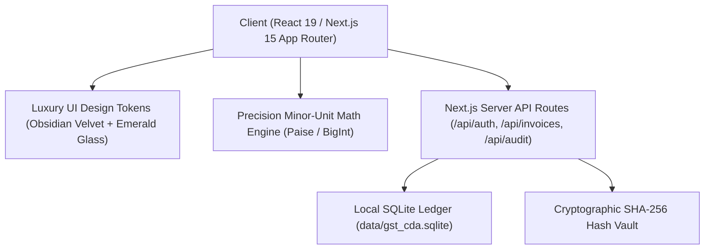

# 🏛️ TaxMate — Smart GST Compliance Companion

> **A Super-Premium, Beginner-First Indian GST Compliance & Tax Filing SaaS Platform.**  
> Built with Next.js 15, React 19, Native SQLite Ledger, and Zero Floating-Point Arithmetic.

[](https://nextjs.org/)
[](https://react.dev/)
[](https://www.sqlite.org/)
[](https://en.wikipedia.org/wiki/Arbitrary-precision_arithmetic)
[](LICENSE)

---

## 🌟 Overview

**TaxMate** is a modern, high-precision compliance and taxation platform designed for Indian MSMEs, Chartered Accountants (CAs), and CSC Kiosk Operators. It bridges the gap between intricate Indian GST law (CGST, SGST, IGST, ITC rules) and everyday business owners by translating complex tax jargon into actionable, transparent, and cryptographically verified financial workflows.

Inspired by elite fintech platforms like **Mercury, Stripe, and Apple Pro**, TaxMate features an obsidian velvet & emerald luxury interface with real-time multi-tenant database isolation.

---

## ✨ Key Features

### 1. 🧮 Zero Floating-Point Error Guarantee
* **Exact Minor-Unit Arithmetic:** All monetary transactions (Taxable Value, CGST, SGST, IGST, and ITC) are stored and calculated strictly in integer minor units (**paise** / `BigInt`).
* **Zero Rounding Drifts:** Eliminates IEEE 754 floating-point inaccuracies (e.g. `0.1 + 0.2 = 0.30000000000000004`), ensuring 100% tax compliance accuracy against government portal specifications.

### 2. 📑 Complete GST Workflow Suite
* **GSTR-1 Outward Sales Ledger:** Record and manage B2B and B2C sales invoices with auto-tax splitting based on Place of Supply (Intra-state CGST + SGST vs Inter-state IGST).
* **GSTR-2B Inward Purchase & ITC Tracker:** Track supplier bills, classify input tax credits (Eligible, Ineligible Section 17(5), Blocked Credits), and maximize tax savings.
* **Automated GSTR-3B Tax Compilation:** Instant mathematical compilation of gross output tax minus eligible ITC to compute exact net tax liability payable before the 20th of every month.
* **Supplier Invoice Matching (2B Reconciliation):** Automatic status reconciliation (`MATCHED`, `MISSING_IN_PORTAL`, `VALUE_MISMATCH`) to prevent audit penalties.

### 3. 🗄️ Native SQLite Persistent Storage
* **Zero Cloud Dependency:** Data is persisted locally in `data/gst_cda.sqlite` via high-speed native `node:sqlite` (`DatabaseSync`).
* **Full Multi-User Isolation:** Each user account (`owner@murugantraders.in`, `cjawaharbharathi@gmail.com`, `ca.audit@taxfirm.in`, `kiosk.service@csc.gov.in`) possesses an isolated workspace and business book.
* **Cryptographic SHA-256 Audit Vault:** Filing authorizations generate tamper-evident SHA-256 cryptographic hashes anchored into an immutable audit table.

### 4. 🎨 Super-Premium Luxury Design System
* **Obsidian Velvet Sidebar:** Deep Midnight Obsidian & Sapphire gradient navigation with glowing emerald active status pills.
* **Glassmorphic Sticky Top Navigation:** Acrylic backdrop blur (`blur(20px)`), floating entity capsule, and live pulsating emerald beacon.
* **Strict Frame Placement:** Responsive 4-card metric grid that dynamically folds without awkward card orphans or viewport clipping.

### 5. 🤖 Built-In GST Assistant & Tools
* **Context-Aware Copilot:** Plain-language assistance answering GST rules, reverse charges, filing deadlines, and penalty exemptions.
* **Tax Calendar & Filing Deadlines:** Interactive tracker for GSTR-1, GSTR-3B, QRMP schemes, and CMP-08 filing dates.
* **CSV Bulk Importer & Exporter:** Export clean CSVs and import legacy spreadsheets with real-time format validation.

---

## 🏗️ Architecture & Tech Stack



| Layer | Technologies |
| :--- | :--- |
| **Framework** | [Next.js 15.2 (App Router)](https://nextjs.org/) |
| **Frontend UI** | [React 19](https://react.dev/), Custom Glassmorphic CSS Design System |
| **Icons** | [Lucide React](https://lucide.dev/) |
| **Database** | Native Node.js SQLite (`node:sqlite` / `DatabaseSync`) |
| **Data Integrity** | Zod Schema Validation, SHA-256 Hashes (`node:crypto`) |
| **Styling** | Zero-dependency, modern pure CSS (Gradients, Glassmorphism, Micro-animations) |

---

## 🚀 Getting Started

### Prerequisites
* **Node.js**: `v22.x` or higher (required for native `node:sqlite` support)
* **npm** or **yarn** / **pnpm**

### Installation

1. **Clone the repository:**
   ```bash
   git clone https://github.com/your-username/gst-cda.git
   cd gst-cda
   ```

2. **Install dependencies:**
   ```bash
   npm install
   ```

3. **Run the development server:**
   ```bash
   npm run dev
   ```

4. **Or build and run in production mode:**
   ```bash
   npm run build
   npm start
   ```

5. **Open in browser:**
   Navigate to [http://localhost:3000](http://localhost:3000).

---

## 👥 Demo Personas (One-Click Logins)

The application includes predefined roles with full database isolation:

| Persona | Email / Identifier | Role | Features |
| :--- | :--- | :--- | :--- |
| **Business Owner** | `owner@murugantraders.in` | `OWNER` | Murugan Electricals & Hardware books, GSTR-1, GSTR-3B filing |
| **Retail Store Owner** | `jawahar@gmail.com` | `OWNER` | Isolated retail business workspace & invoice entries |
| **Chartered Accountant** | `ca.audit@taxfirm.in` | `CA` | Audit trails, cryptographic hash inspections, client management |
| **Kiosk Operator** | `kiosk.service@csc.gov.in` | `KIOSK_OPERATOR` | Simplified village kiosk & assisted return filing workflow |

---

## 🔒 Security & Privacy

* **100% Local & Private:** All financial figures, customer names, and GSTIN numbers remain within your local `data/gst_cda.sqlite` file. No third-party analytics or external telemetry.
* **Immutable Audit Trail:** Authorizing any GSTR-3B return generates an immutable record with a cryptographically verifiable SHA-256 fingerprint:
  $$\text{Audit Hash} = \text{SHA256}(\text{GSTIN} + \text{Period} + \text{NetPaise} + \text{Timestamp})$$

---

## 📄 License

This project is licensed under the **MIT License** — feel free to use and adapt it for commercial or educational purposes.

