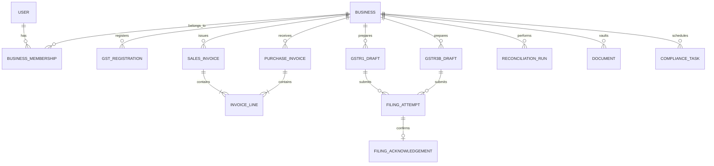

# TaxMate - Data Dictionary & Relational Schema

**Entity Relationships & Minor Unit (Paise) Storage Model**

---

## 1. Relational Entity Overview

---

## 2. Core Entities Data Dictionary

### 2.1 `SalesInvoice` & `PurchaseInvoice`
Financial amounts are stored as 64-bit integers (`BigInt`) representing paise (1 INR = 100 paise) to prevent floating-point rounding errors.

| Field | Type | Storage Format | Description |
|:---|:---|:---|:---|
| `id` | String (CUID) | `cuid()` | Unique invoice record key |
| `businessId` | String (CUID) | Foreign Key | Enforces multi-tenant isolation |
| `invoiceNumber` | String | e.g., `"INV-2026-001"` | Supplier or sales sequence number |
| `invoiceDate` | DateTime | ISO 8601 | Statutory invoice date |
| `placeOfSupply` | String(2) | State Code (e.g. `"33"`) | Determines Intra vs Inter-state supply |
| `taxableAmount` | BigInt | Minor units (Paise) | Base taxable value before tax |
| `cgstAmount` | BigInt | Minor units (Paise) | Central GST amount |
| `sgstAmount` | BigInt | Minor units (Paise) | State GST amount |
| `igstAmount` | BigInt | Minor units (Paise) | Integrated GST amount |
| `totalAmount` | BigInt | Minor units (Paise) | `taxableAmount + cgst + sgst + igst` |
| `status` | String | `DRAFT`, `CONFIRMED` | Local workflow state |
| `itcEligibility` | String | `ELIGIBLE`, `INELIGIBLE` | Applicable to purchase invoices only |

### 2.2 `FilingAttempt` & `FilingAcknowledgement`
Guarantees idempotency, auditability, and immutability for statutory return submissions.

| Field | Type | Description |
|:---|:---|:---|
| `idempotencyKey` | String (UUIDv4) | Generated per user authorization action to prevent duplicate submissions |
| `correlationId` | String | Unique trace token passed to GSP request headers |
| `arn` | String | Application Reference Number returned from GSTN on successful validation |
| `acknowledgementHash`| String | SHA-256 hash of the exact submitted payload + portal response |

