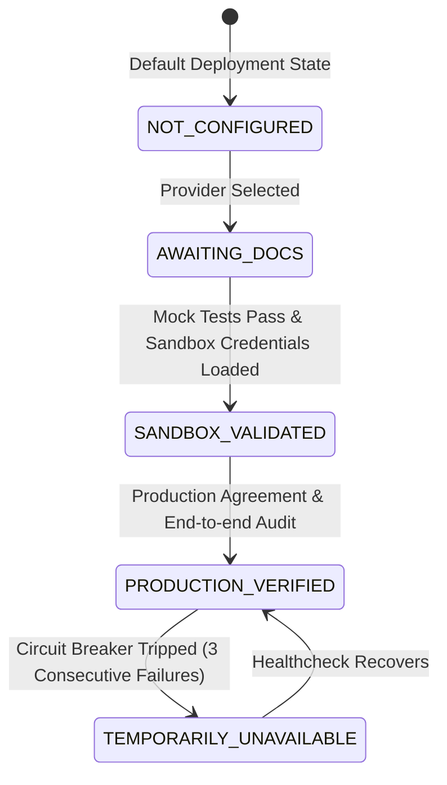

# GST CDA - Integration Capability Matrix & Registry

**Workbook Analysis Version:** 1.0.0  
**Total Catalogued Endpoints:** 182 APIs  
**Golden Rule:** A "Working" cell in a test workbook is not a production guarantee. No endpoint may be called or represented as production-ready from the workbook alone.

---

## 1. Status Breakdown

| Workbook Status | Count | Production Implementation Decision |
|:---|---:|:---|
| **Working** (inc. lowercase `working`) | **96** | Implement typed adapter contracts, UI workflows, feature flags, mocked contract tests, and a **disabled-by-default** state. Enable only after provider credentials, IP whitelisting, and end-to-end sandbox validation. |
| **Partial Working** | **2** | Treat as disabled/unavailable until the provider documents supported subsets and verified constraints. |
| **Not Working** | **6** | Excluded from product invocation. Surface a graceful unavailable status in UI and use local draft computation. |
| **Not Tested** | **77** | Backlog items only; feature-flagged off with "Pending Provider Certification" badge. |
| **No Status / Unknown** | **1** | Treated as unknown/disabled. |
| **Total** | **182** | **100% catalogued with typed capability flags.** |

---

## 2. Capability Groups & Implementation Registry

### 2.1 Session & Public Verification Services (Working - 11 APIs)
*Contracts implemented in `packages/integrations/core/registry.ts`, disabled until configured:*
- `AUTH_OTP_REQUEST`: Request OTP for EVC / Authentication
- `AUTH_OTP_INITIATE_EVC`: Initiate OTP for return filing EVC
- `AUTH_TOKEN_REQUEST`: Request authentication token from GSP
- `AUTH_TOKEN_EXTEND`: Extend session authorization token
- `AUTH_LOGOUT`: Terminate active GSP/GSTN session
- `PUB_COMMON_AUTH`: Public common authentication service
- `PUB_PREFERENCES`: Taxpayer preference retrieval
- `PUB_GSTIN_VERIFY`: Online GSTIN verification
- `PUB_GSTIN_UPDATED_VERIFY`: Updated taxpayer status verification
- `PUB_TAXPAYER_SEARCH`: Public taxpayer name/PAN search
- `PUB_RETURN_TRACK`: View and track return filing history by GSTIN

### 2.2 GSTR-1 Sales Return Services (Working - 28 APIs)
- `GSTR1_FILE`: Cryptographic submission with EVC/DSC
- `GSTR1_SAVE`: Save outward supplies payload to GSTN
- `GSTR1_RESET`: Reset return data on portal
- `GSTR1_STATUS`: Track filing status
- `GSTR1_SUMMARY_GET`: Fetch return summary
- `GSTR1_HSN_VALIDATE`: Validate HSN summary items
- `GSTR1_B2B_GET` / `GSTR1_B2BA_GET`: Retrieve B2B & amended supplies
- `GSTR1_B2CL_GET` / `GSTR1_B2CLA_GET`: Large consumer outward supplies
- `GSTR1_B2CS_GET` / `GSTR1_B2CSA_GET`: Small consumer outward supplies
- `GSTR1_CDNR_GET` / `GSTR1_CDNRA_GET`: Registered credit/debit notes
- `GSTR1_CDNUR_GET` / `GSTR1_CDNURA_GET`: Unregistered credit/debit notes
- `GSTR1_EXP_GET` / `GSTR1_EXPA_GET`: Export outward supplies
- `GSTR1_AT_GET` / `GSTR1_ATA_GET`: Advance tax received & amended
- `GSTR1_TXP_GET` / `GSTR1_TXPA_GET`: Tax paid on advances & amended
- `GSTR1_NIL_GET`: Nil rated supplies
- `GSTR1_DOC_ISSUED_GET`: Documents issued summary
- `GSTR1_EINVOICE_GET`: Auto-populated e-invoices
- `GSTR1_ECOM_GET`: Supplies through e-commerce operators
- `GSTR1_SUPECO_GET` / `GSTR1_SUPECOA_GET`: Supplies under 9(5) and amended

### 2.3 GSTR-1A Services (Working - 2 APIs, Partial - 1 API)
- `GSTR1A_FILE`: File GSTR-1A outward supply amendments (Working)
- `GSTR1A_SUMMARY_GET`: Retrieve GSTR-1A summary (Working)
- `GSTR1A_SAVE`: Save GSTR-1A payload (**Partial Working - Disabled**)

### 2.4 Purchase, ITC & IMS (Invoice Management System) (Working - 21 APIs, Partial - 1 API)
- `GSTR2A_B2B_GET` / `GSTR2A_B2BA_GET`: Inward B2B supplies
- `GSTR2A_CDN_GET` / `GSTR2A_CDNA_GET`: Inward credit/debit notes
- `GSTR2A_ISD_GET`: Input service distributor credit
- `GSTR2A_IMPG_GET` / `GSTR2A_IMPGSEZ_GET`: Import of goods & SEZ supplies
- `GSTR2A_TDS_GET` / `GSTR2A_TCS_GET`: Inward TDS and TCS credits
- `GSTR2A_ECOM_GET` / `GSTR2A_ECOMA_GET`: E-commerce inward details
- `GSTR2A_AMDHIST_GET`: Amendment history
- `GSTR2B_GENERATE_ONDEMAND`: On-demand auto-drafted ITC statement generation
- `GSTR2B_GEN_STATUS`: Generation status check
- `GSTR2B_ALL_DETAILS_GET`: Comprehensive GSTR-2B data retrieval
- `IMS_ADDED_BACK_LIABILITY`: Fetch IMS liability added back
- `IMS_REQUEST_STATUS`: Check status of IMS requests
- `IMS_INVOICE_COUNT`: Inward invoice count in IMS
- `IMS_SUPPLIER_INVOICES`: Invoices received from suppliers
- `IMS_RESET_SAVE_ACTION`: Save/reset recipient action (Accept, Reject, Pending)
- `IMS_FILE_DETAILS`: Detailed IMS filing records
- `IMS_GET_INVOICES`: (**Partial Working - Disabled**)

### 2.5 GSTR-3B Summary & Offset Services (Working - 18 APIs)
- `GSTR3B_FILE`: Cryptographic filing with EVC / DSC
- `GSTR3B_GET_DETAILS`: Retrieve portal GSTR-3B details
- `GSTR3B_SAVE_VALIDATE`: Save and validate draft return
- `GSTR3B_AUTO_CALCULATED_ITC`: Retrieve auto-computed ITC from 2B
- `GSTR3B_AUTO_CALCULATED_LIABILITY`: Retrieve auto-computed liability from 1
- `GSTR3B_ITC_REVERSAL`: Save ITC reversal breakdowns
- `GSTR3B_RCM_OPENING_BAL`: Retrieve RCM opening balance
- `GSTR3B_SYSTEM_INTEREST`: Portal auto-computed interest
- `GSTR3B_RECOMPUTE_INTEREST`: Recompute interest with user dates
- `GSTR3B_OFFSET_LIABILITY`: Offset tax liability using ITC cash ledger

### 2.6 Not Working APIs (6 APIs - Safely Disabled)
1. `GSTR1_ECOMA_GET`: E-commerce amendment retrieval
2. `GSTR1_HSN_SUMMARY_GET`: Direct HSN summary retrieval (use local deterministic aggregation)
3. `GSTR3B_SUBMIT_RCM_OPENING_BAL`: Submit RCM opening balance to GSTN
4. `GSTR4_4A_4B_AUTOPOP_GET`: Composition inward autopopulation
5. `GSTR4_TDSCMP_SUMMARY_GET`: Composition TDS summary
6. `GSTR6_CDNA_GET`: ISD credit/debit note amendment retrieval

### 2.7 Not Tested APIs (77 APIs) & Unknown (1 API)
- GSTR-1A retrieval APIs (7 items)
- GSTR-4 filing & validation APIs (12 items)
- GSTR-6 filing, ISD distribution, late fee offset (14 items)
- GSTR-7 TDS save & file (4 items)
- GSTR-8 E-commerce operator returns (all 8 items)
- GSTR-9 / 9C annual return writes & filing (20 items)
- Transition & Composition forms: ITC-01, ITC-03, ITC-04, CMP-08 (12 items)
- `ALL_NEW_PROCEED_TO_FILE`: Unstatused entry (1 item)
*All kept in backlog registry with state `DISABLED_UNVERIFIED`.*

---

## 3. Circuit Breaker & Safety Strategy

