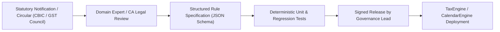

# TaxMate - Legal & Deterministic Rule Governance

**Governance Standard:** Section 9 of System Specification  
**Core Rule:** No LLM, heuristic guess, or hard-coded assumptions may determine final tax liabilities, return due dates, or Input Tax Credit (ITC) eligibility.

---

## 1. Rule Governance Lifecycle



1. **Intake & Source Evidence:** Any amendment to rates, exemption thresholds, late fee calculations, or return deadlines must cite the official CBIC notification number and effective date.
2. **Effective Dating:** All rules are stored with explicit `effectiveFrom` and optional `effectiveTo` timestamps. Transactions and filings are calculated against the statutory rules in effect on their transaction date, never the current deployment date.
3. **Traceability:** Every tax computation produces a full calculation trace detailing:
   - Evaluated place of supply vs supplier/recipient state codes.
   - Identified tax slab (0%, 0.25%, 3%, 5%, 12%, 18%, 28%).
   - Exact minor units (paise) integer math with statutory half-paisa rounding rules.
   - Applied rule version identifier.

---

## 2. Tax Calculation Determinism

```typescript
// Deterministic Tax Evaluation Principle
export function calculateTax({
  taxablePaise,
  taxRatePercent,
  supplierStateCode,
  placeOfSupplyStateCode
}: TaxCalculationInput): TaxCalculationResult {
  const isIntraState = supplierStateCode === placeOfSupplyStateCode;
  
  if (isIntraState) {
    // Split equally into CGST & SGST (each rate / 2)
    const halfRate = taxRatePercent / 2;
    const cgst = Math.round((Number(taxablePaise) * halfRate) / 100);
    const sgst = Math.round((Number(taxablePaise) * halfRate) / 100);
    return {
      supplyType: 'INTRA',
      taxablePaise,
      cgstPaise: BigInt(cgst),
      sgstPaise: BigInt(sgst),
      igstPaise: BigInt(0),
      totalPaise: taxablePaise + BigInt(cgst) + BigInt(sgst)
    };
  } else {
    // Inter-State Supply (IGST = full rate)
    const igst = Math.round((Number(taxablePaise) * taxRatePercent) / 100);
    return {
      supplyType: 'INTER',
      taxablePaise,
      cgstPaise: BigInt(0),
      sgstPaise: BigInt(0),
      igstPaise: BigInt(igst),
      totalPaise: taxablePaise + BigInt(igst)
    };
  }
}
```

---

## 3. Statutory Fallback Policies

- If a user provides an invalid GSTIN or conflicting place of supply, the tax engine halts calculation and marks the row with a blocking validation issue (`MISSING_REQUIRED_FACTS`).
- Missing statutory deadlines trigger a state of `"Deadline Unavailable - Pending Official Announcement"` rather than an arbitrary default date.

